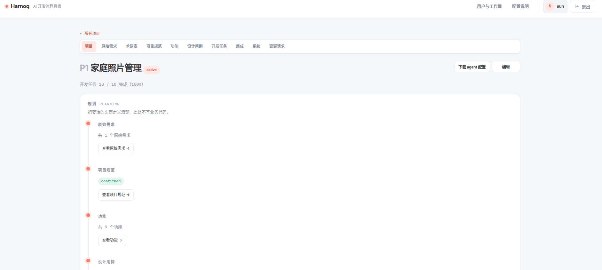
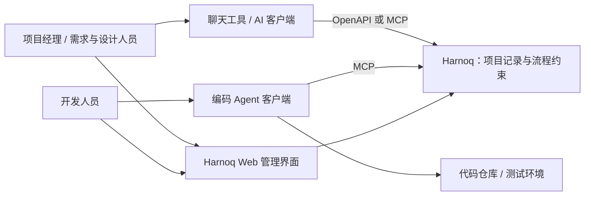

# Harnoq

[中文](README.md) · [English](../en/README.md)

**让 AI Agent 在明确的工程约束下，完成可控、可追溯的软件开发。**

Harnoq 是一套面向 AI 辅助开发的项目管理系统。它将需求、规范、功能、设计、开发任务和验证记录串联起来，为 Agent 提供当前阶段的工作方法、任务范围与验收依据，让团队能够回答：为什么做这项变更、依据什么设计、如何验证，以及最终交付了什么。



## 为什么做 Harnoq

AI Agent 能快速生成代码，但在持续演进的项目中，仅靠对话和提示词，很难始终保持需求、设计与实现的一致性。Harnoq 的出发点是：**把工程约束落实到工作流程中，让 Agent 围绕明确的任务与验收标准推进工作。**

面向企业开发，Harnoq 关注三个问题：

- **过程可控**：将项目规范、设计确认、开发前审查和验证要求纳入流程，减少遗漏、越界实现和未经确认的变更。
- **结果可追溯**：保留需求、设计、任务、变更与验证记录之间的关联，帮助团队理解系统如何演进、问题如何解决。
- **上下文有边界**：把项目拆解为范围明确的任务，为执行 Agent 提供相关上下文，减少反复阅读整个项目的成本。

设计动机见[初步设计](initial_design.md#ai-agent的优缺点)。该文档记录最初的思考；当前行为以实现及接入文档为准。

## Harnoq 在开发工具链中的位置

Harnoq 专注于两件事：**记录项目，指导 Agent**。它提供 Web 管理界面、HTTP/OpenAPI 接口和 MCP 接口，与团队已有的聊天工具和开发工具配合使用。



- **需求与设计协作**：通过聊天工具与 AI 讨论需求、梳理功能和细化设计，再将结果记录到 Harnoq；也可以通过 Web 界面维护这些内容。
- **开发与验证协作**：编码 Agent 通过 MCP 获取任务及相关上下文，按照 Harnoq 提供的工作方法推进开发、验证和结果记录。

Harnoq 本身不运行大模型，也不代替编码客户端或 Git 托管平台执行开发、提交与合并。模型调用和代码执行由接入的客户端负责，Harnoq 管理相应的流程状态与证据记录。

## 项目如何推进

项目的主要流程是：**原始需求 → 项目规范 → 功能 → 设计用例 → 开发任务 → 集成验证 → 系统验证**。术语表提供共同的业务语言，变更请求承接后续需求与缺陷。

| 环节 | 作用 |
| --- | --- |
| 原始需求 | 保存需求描述、讨论结论等原始材料，作为后续分析的依据。 |
| 术语表 | 明确项目中关键术语的含义，减少人与 Agent 之间的理解偏差。 |
| 项目规范 | 约定工程原则、代码风格与开发约束，并用于生成下游 Agent 的指导文件。 |
| 功能 | 将需求划分为明确的功能范围，记录功能之间的依赖。 |
| 设计用例 | 围绕功能细化方案、边界和验收标准，为开发任务提供依据。 |
| 开发任务 | 将设计转化为范围明确的工作单元，记录执行过程和验证结果。 |
| 集成验证 | 检查多个任务或模块组合后的协作行为。 |
| 系统验证 | 从完整系统的角度验证整体行为与交付要求。 |
| 变更请求 | 记录新增需求、缺陷与调整，经过相应流程后形成后续任务。 |

### 一个开发任务如何完成

开发任务通常经历以下步骤：

1. **领取与审查**：获取任务、关联设计和项目规范，确认范围、验收标准及适用的审批要求。
2. **开发**：由负责实现的 Agent 在任务范围内编写代码并执行必要检查。
3. **测试与审查**：由独立的 QA Agent 验证验收标准，检查设计一致性、实现范围和边界情况；发现问题后返回修复。
4. **提交与完成**：验证通过后提交 PR，并在合并得到确认后记录交付结果、完成任务。

下游 Agent 模板通过主 Agent 协调实现与 QA 子 Agent，让每个执行角色聚焦自己的任务。上下文拆分有助于控制模型调用成本，也为本地模型参与开发提供条件；实际效果仍取决于模型能力、客户端支持和任务复杂度。

## 快速开始

### 环境要求

- Python 3.14 或更高版本。
- [uv](https://docs.astral.sh/uv/)：用于安装依赖和运行项目。
- 默认使用 SQLite，无需额外启动数据库服务。

### 安装与启动

在仓库根目录执行：

```bash
uv sync

# 首次使用时创建管理员，按提示输入用户名、显示名和密码。
uv run flask --app main create-admin

# 启动 Web、HTTP API 和 MCP 服务。
uv run python main.py
```

打开 [http://127.0.0.1:5000](http://127.0.0.1:5000)，使用管理员账号登录并创建项目。页面顶部的 **English / 中文** 下拉框可切换界面语言，选择保存在当前浏览器；首次访问默认英文，不随浏览器语言自动切换。切换语言不会翻译已有项目内容。

默认启动命令监听 `0.0.0.0:5000`，同一进程提供以下入口：

| 入口 | 地址 |
| --- | --- |
| Web 管理界面 | `http://127.0.0.1:5000/` |
| OpenAPI 描述 | `http://127.0.0.1:5000/openapi.json` |
| MCP 服务 | `http://127.0.0.1:5000/mcp` |

默认数据文件为仓库目录下的 `harnoq.db`，JWT 签名密钥首次启动时自动生成并保存在 `instance/jwt-secret`。可通过 `HARNOQ_SQLITE_PATH` 和 `HARNOQ_JWT_SECRET` 覆盖；指定的 JWT 密钥需至少 32 字节。重新启动时应保留数据文件与密钥。

以上是本地启动方式。服务部署到其他机器后，客户端地址中的 `127.0.0.1` 应替换为实际可访问的主机地址。

### 接入 AI 客户端

1. 登录 Web 界面，在 **“我的账号”** 中创建个人 MCP/API 凭据。
2. 按客户端类型选择接入方式：支持 OpenAPI 工具的客户端使用 OpenAPI 接口；支持 MCP 的客户端连接 `/mcp`。调用时使用个人凭据进行 Bearer 认证。
3. 确认项目规范后，可在项目页面下载适用于下游代码仓库的 Agent 配置文件。

完整配置、认证方式及下游仓库初始化步骤见[客户端接入指南](skills/README.md)。

## 开发与文档

运行测试：

```bash
uv run pytest
```

主要目录：

```text
app/          Web 界面、API、业务逻辑与数据模型
harnoq_mcp/   MCP 适配层
skills/       OpenAPI 定义与客户端接入说明
scripts/      下游仓库初始化等辅助脚本
tests/        自动化测试
evals/        Agent 工作流程评估工具
docs/         设计说明与 API 文档
```

进一步阅读：

- [客户端接入指南](skills/README.md)：OpenAPI、MCP 和下游仓库配置。
- [API 文档](api.md)：接口与工作流程约定。
- [MCP 适配层](mcp/README.md)：适配层结构及独立运行方式。
- [设计演进](design-evolution.md)：关键设计决策与调整原因。
- [流程评估](evals/README.md)：评估工具的使用方式。

开发 Harnoq 本身时，请遵循 [AGENTS.md](../../AGENTS.md)。面向任意项目的提示词与模板应描述通用机制和判据，避免将某个测试项目的内容固化为通用规则。

## 许可证

Harnoq 采用 [Apache License 2.0](../../LICENSE)。允许商业使用、修改和分发，也允许用于闭源衍生产品；分发时需遵守许可证中的声明保留、修改说明等要求。完整条款以 [LICENSE](../../LICENSE) 为准。
