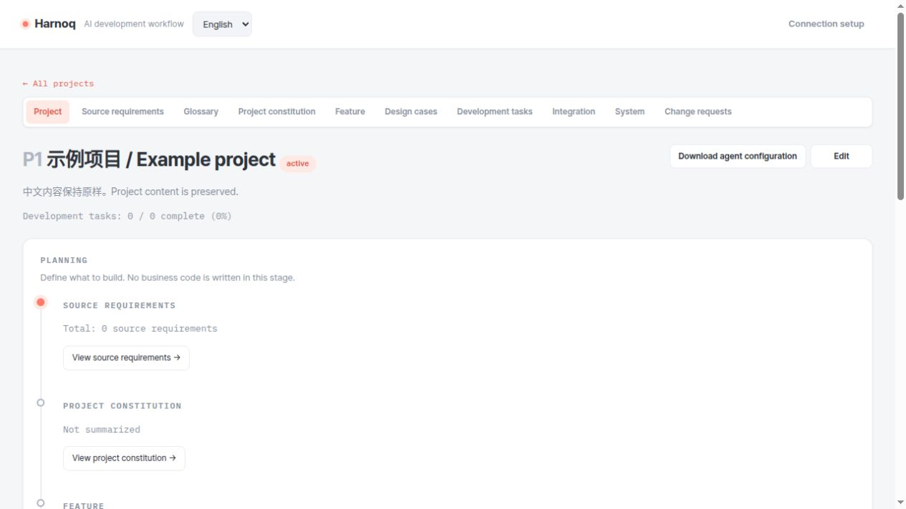
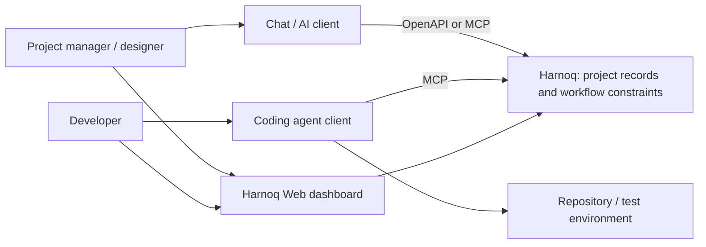

# Harnoq

**Controlled, traceable software development with AI agents.**

[English](README.md) · [中文](../cn/README.md)

Harnoq is a project management system for AI-assisted engineering. It connects requirements, project rules, features, designs, development tasks, and verification evidence. Agents receive the working method, scope, and acceptance criteria for their current stage, while the team can trace why a change was made, what design it follows, and how it was verified.



## Why Harnoq

Fast code generation does not by itself keep requirements, designs, and implementation aligned as a project evolves. Harnoq puts engineering constraints into the workflow:

- **Control:** project rules, design confirmation, pre-development review, and verification requirements define the boundaries of execution.
- **Traceability:** connected requirements, designs, tasks, changes, and evidence explain how the system evolved.
- **Bounded context:** clearly scoped tasks give each agent the relevant context without repeatedly reading the entire project.

The [initial design](initial_design.md#strengths-and-limitations-of-ai-agents) records the motivation. It is historical context; implementation and current interface documentation define present behavior.

## Where Harnoq fits

Harnoq **records the project and guides agents**. Its Web dashboard, HTTP/OpenAPI API, and MCP endpoint work with existing chat and coding clients.



Discuss requirements and designs in a connected client, then record the results in Harnoq, or edit them through the Web dashboard. Coding agents retrieve tasks and context through MCP and report implementation and verification results.

Harnoq does not run models or execute Git operations. Clients run models, edit code, and execute tests; the Git hosting platform handles pull requests and merges. Harnoq records workflow state and submitted evidence.

## Project workflow

**Source requirements → project constitution → features → design cases → development tasks → integration verification → system verification.** A glossary supplies shared vocabulary, and change requests capture subsequent changes and defects.

| Stage | Purpose |
| --- | --- |
| Source requirements | Preserve original requirements and discussion outcomes. |
| Glossary | Disambiguate terms that people or agents would otherwise misuse. |
| Project constitution | Establish stack, engineering rules, UI conventions, quality requirements, and boundaries. |
| Features | Define delivery scope, ownership, and feature dependencies. |
| Design cases | Specify module contracts, solutions, trade-offs, and acceptance criteria. |
| Development tasks | Execute bounded work and record verification results. |
| Integration | Verify assembly, module seams, and duplicate responsibilities. |
| System | Verify complete user journeys and non-functional commitments. |
| Change requests | Assess and authorize changes before creating subsequent work. |

### Completing a development task

1. **Claim and review:** read the task, its sources, design, and constitution; check scope, acceptance criteria, and applicable approval requirements.
2. **Implement:** the coding agent works within the task boundary and performs necessary checks.
3. **Test and review:** an independent QA agent verifies acceptance criteria, design compliance, scope, and edge cases. Failed work returns for repair.
4. **Deliver:** create a PR after verification, then record its confirmed merge and complete the task.

Generated agent configurations let a manager coordinate coder and QA roles. Smaller contexts can reduce repeated model work and help local models participate, but results depend on model capability, client support, and task complexity.

## Quick start

Requires **Python 3.14+** and [uv](https://docs.astral.sh/uv/). SQLite is the default database; no separate database server is required.

Run from the repository root:

```bash
uv sync
# First-time setup: enter username, display name, and password when prompted.
uv run flask --app main create-admin
uv run python main.py
```

Open [http://127.0.0.1:5000](http://127.0.0.1:5000), sign in, and create a project. Use the **English / 中文** dropdown in the header to switch the interface language. The choice is saved in a browser cookie; English is the default on first visit, regardless of the browser's language. Project content is not translated.

The command listens on `0.0.0.0:5000` and serves all three interfaces in one process:

| Interface | Local URL |
| --- | --- |
| Web dashboard | `http://127.0.0.1:5000/` |
| OpenAPI specification | `http://127.0.0.1:5000/openapi.json` |
| MCP | `http://127.0.0.1:5000/mcp` |

The default database is `harnoq.db`. A JWT signing secret is generated on first startup at `instance/jwt-secret`. Override these with `HARNOQ_SQLITE_PATH` and `HARNOQ_JWT_SECRET` (at least 32 bytes). Preserve the database and secret across restarts. For a remote deployment, replace `127.0.0.1` in client settings with the reachable server address.

### Connect an AI client

1. Create a personal MCP/API credential under **My account**.
2. Connect an OpenAPI-compatible client to the specification, or an MCP client to `/mcp`, using Bearer authentication with your credential.
3. After confirming the project constitution, download the downstream agent configuration from the project page.

See the [client connection guide](skills/README.md) for authentication, client configuration, and repository initialization.

## Development and documentation

```bash
uv run pytest
```

| Directory | Contents |
| --- | --- |
| `app/` | Web UI, API, services, and data models |
| `app/locales/` | Shared UI translation catalog |
| `harnoq_mcp/` | MCP adapter |
| `skills/` | OpenAPI specification and runtime prompts |
| `scripts/` | Repository initialization and maintenance utilities |
| `tests/` | Automated tests |
| `evals/` | Agent workflow evaluations |
| `docs/en/`, `docs/cn/` | English documentation (default) and Chinese translation |
| `docs/assets/` | Shared images |

- [Client connection guide](skills/README.md)
- [API reference](api.md)
- [MCP adapter](mcp/README.md)
- [Design evolution and rationale](design-evolution.md)
- [Phased delivery plan](phased_delivery_plan.md)
- [Behavioral evaluations](evals/README.md)
- [Internationalization maintenance](i18n.md)

Follow [AGENTS.md](../../AGENTS.md) when developing Harnoq. Generic prompts must express mechanisms and criteria, without turning a particular evaluation project's domain content into universal rules.

## License

Harnoq is licensed under the [Apache License 2.0](../../LICENSE). It permits commercial use, modification, distribution, and proprietary derivatives subject to its notice, modification, and other requirements. See the full license for the governing terms.
